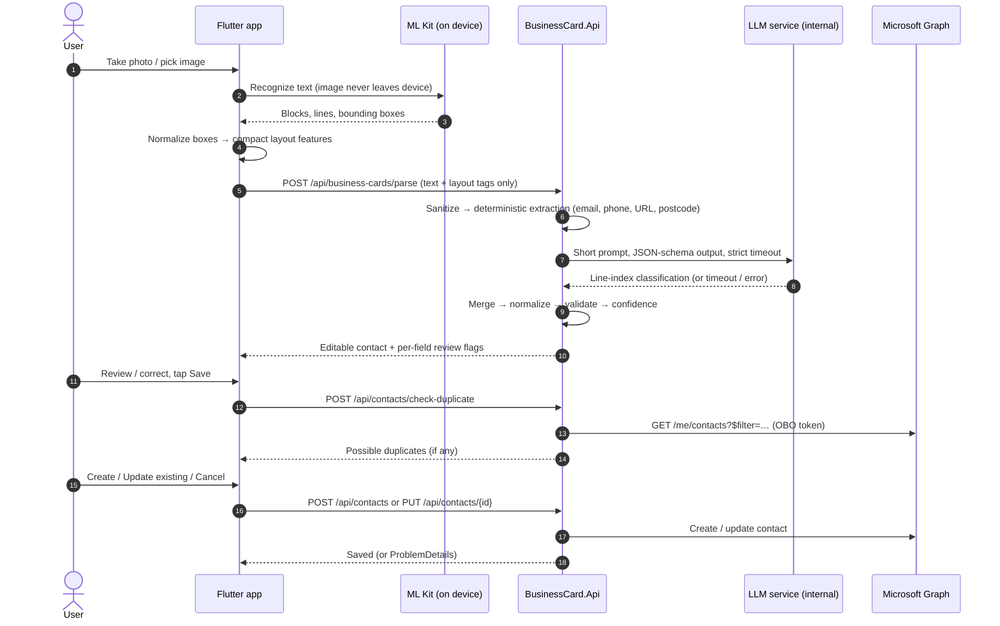

# Architecture

Business Card Scanner is a corporate MVP: a Flutter app reads a business card **on the device**,
a stateless .NET 8 API turns the OCR output into a structured contact using deterministic rules plus a
small self-hosted LLM, the user reviews and edits it, and the API saves it to the signed-in user's
Outlook / Exchange Online contacts through Microsoft Graph.

Guiding rule: *production-suitable, simple to maintain, no architecture for its own sake.*

---

## 1. End-to-end flow



The **image stays on the device** and is never persisted. The backend receives only OCR text lines with
compact layout tags. The LLM receives an even smaller, tagged text prompt.

---

## 2. Components

| Component | Tech | Responsibility |
|---|---|---|
| `mobile/` | Flutter, Riverpod, Dio, go_router, ML Kit | Sign-in, capture, on-device OCR, layout features, review/edit UI, save flow |
| `backend/src/BusinessCard.Api` | ASP.NET Core 8 | Endpoints, JWT validation, ProblemDetails, Swagger, Serilog, DI composition |
| `backend/src/BusinessCard.Application` | .NET 8 | Parsing orchestration (hybrid parser), contact use cases, DTOs, FluentValidation |
| `backend/src/BusinessCard.Domain` | .NET 8, no packages | Contact model, field names, small value objects that earn their place |
| `backend/src/BusinessCard.Infrastructure` | .NET 8 | Graph contact service, LLM HTTP client, external configuration |
| `inference/` | llama.cpp `llama-server` | Hosts Phi-4-mini-instruct behind an internal OpenAI-compatible HTTP endpoint |

Dependencies flow inward: `Api → Application ← Infrastructure`, `Application → Domain`.
Application defines the two interfaces whose implementations are replaceable external systems
(`IBusinessCardLlmClassifier`, `IMicrosoftGraphContactService`); Infrastructure implements them.

There is **no database**. Graph is the source of truth for saved contacts. The API is stateless and
scales horizontally behind a load balancer if needed.

---

## 3. Key decisions

Each decision lists *why it fits an MVP*. Revisit only with evidence.

### D1. Monorepo with three deployables
`backend/`, `mobile/`, `inference/` in one repository. The API contract changes in lockstep across
mobile and backend; one repo keeps that change atomic. No shared code generation in the MVP; contracts
are small enough to maintain by hand and are covered by tests on both sides.

### D2. Modular monolith API, no MediatR/CQRS/repositories
Controllers call application services directly. Four projects give a clear dependency direction without
ceremony. Interfaces exist only where an implementation is genuinely swappable (LLM, Graph) or must be
faked in tests.

### D3. On-device OCR with compact layout features
Google ML Kit Text Recognition (Latin script) runs locally: no image upload, no OCR cost, and good
latency. Flat text loses the visual hierarchy that distinguishes *company* from *person*, so the app
converts bounding boxes into a few stable, categorical features per line:

Coordinates are normalized to the **text extent** (union of all line boxes) rather than the photo: a card
rarely fills the frame, and normalizing to the photo would label most lines `center`.

| Feature | Values | Derivation (`LayoutExtractor`) |
|---|---|---|
| `order` | 1..n | ML Kit line order inside a block; blocks ordered geometrically: top-to-bottom, rows (tops within ½ line height) left-to-right. **Two columns** when narrow blocks (≤ 60 % width) split into groups with a ≥ 4 % gutter that overlap vertically ≥ 25 %: left column first; full-width blocks keep their vertical position |
| `region` | `top` / `center` / `bottom` | normalized y-centre `< 0.33`, `< 0.66`, else |
| `size` | `small` / `normal` / `large` | line height ÷ median line height: `< 0.8`, `> 1.25`, else normal |
| `align` | `left` / `center` / `right` | centre within ±0.1 of the middle and not starting at the left edge → center; ends ≥ 0.92 and starts > 0.25 → right; else left |
| `sameBlock` | bool | same ML Kit block as the previous line |
| `gap` | `none` / `small` / `large` | space above ÷ median height: `< 0.6`, `< 1.5`, else large; a line entirely above the previous one (new column) is `large`; same-row neighbours are `none` |

Wire shape per line: `{"text","order","region","size","align","sameBlock","gap"}`, where `order` is the only
number. A contract test enforces this.

**Capture** uses `image_picker` (system camera and photo picker) rather than an in-app `camera` preview:
the OS handles focus, flash and orientation, Android needs no `CAMERA`/storage permission, and images
arrive downscaled to 2048 px with metadata stripped, which keeps OCR fast. The image is a temporary copy
deleted when the user leaves the scan flow. An in-app camera with a card-alignment guide is a possible
later improvement if OCR measurements show framing problems.

**OCR output** is mapped at the plugin boundary into app types (`OcrResult`: upright image size,
lines with text, box, ML Kit block/line index, optional confidence), so layout extraction is pure,
plugin-free Dart. ML Kit boxes refer to the upright image while a JPEG header may report pre-rotation
dimensions; if the boxes only fit the swapped size, width and height are swapped (`resolveUprightSize`).
The image file is deleted right after successful recognition.

Raw pixel coordinates never leave the device. The extractor is a pure Dart function with unit tests. It
is deliberately *not* a document-layout engine.

### D4. Hybrid parser: deterministic first, LLM only for semantics
`HybridBusinessCardIntelligenceService` runs:

1. **Sanitize**: strip control characters, collapse whitespace, cap line count and length.
2. **Garbage filter**: drop lines that are mostly symbols, single characters, or typical logo noise.
3. **Deterministic extraction**: email, URL, phone, postal code, run per line in that order on the text
   left by the previous step (so an email domain never becomes a website and phone digits never become a
   postal code). Phones use **libphonenumber** (default region TR, E.164 for comparison, international format
   for display); the number's type decides mobile vs business, labels decide fax (dropped) and ambiguous number
   plans. Postal codes: Turkish plate-prefix 5-digit codes in address-like lines, with a province-based city
   hint. Lines consisting only of extracted values and labels are *consumed* and not sent to the LLM.
4. **LLM classification** of the remaining lines (see D5), using each line's *residual* text (extracted
   values and their labels removed), so a validated phone number can never end up inside a name.
5. **Merge** with fixed precedence (below).
6. **Normalize**: casing, Turkish characters, first/last name split, website protocol.
7. **Validate**: FluentValidation rules shared with the save path.
8. **Confidence**: per-field score and `needsReview` flag from multiple signals (D7).

Source precedence:

| Field | Winner |
|---|---|
| Email, phones, website | Deterministic (validated). The LLM is never asked for these. |
| Postal code | Deterministic when pattern-matched; otherwise LLM. |
| City / country | LLM, with the deterministic province hint as corroboration (and as fallback when the LLM is unavailable). |
| Person name, company, title, department, street, city, state, country | LLM, cross-checked against layout and deterministic hints (e.g. email domain ↔ company) |

### D5. LLM: Phi-4-mini-instruct on llama.cpp, line-index output
**Serving:** `llama-server` (llama.cpp) with a GGUF Q4_K_M build of Phi-4-mini-instruct. It is one
binary or container, keeps the model resident (no per-request load), exposes an OpenAI-compatible
`/v1/chat/completions` API, supports JSON-schema-constrained decoding, and runs on CPU with optional
GPU offload. vLLM needs a GPU and more operational work, which is not justified for ~50 output tokens per
request. The same server can run Gemma or Qwen GGUF builds, so the API client does not change between
models.

**Output contract (internal, latency-driven):** the model returns **line indexes**, not copied text:

```json
{"person":[2],"company":[1],"title":[3],"dept":[],"address":[6,7],
 "city":"İstanbul","state":null,"country":null}
```

The prompt (`inference/contract/system-prompt.txt`) and schema (`inference/contract/classification.schema.json`)
are versioned files shared by the backend (embedded at build time) and the smoke test. Input lines are
`<id> [REGION][SIZE] text`, where `<id>` is the line's reading order, so returned ids map straight back to lines.
The fixed system prompt comes first so llama-server's prompt cache skips re-processing it.

Why:
- *Latency.* Output tokens dominate small-model latency (decode is ~15–30 tok/s on a server CPU for a
  3.8B Q4 model). Index output is ~40–60 tokens versus ~120+ for copied values.
- *No invention.* The model can only point at lines that exist. Free-text fields (`city`, `state`,
  `country`) are accepted only when they appear in the input text (diacritic-insensitive), or for
  `country` when it maps from a small known table, in which case the field is flagged for review.
- *Deterministic text.* Exact strings come from OCR, then deterministic normalization.

Prompt rules: short fixed system prompt, tagged lines (`[2][CENTER][LARGE] Ahmet Yılmaz`), `temperature 0`,
`max_tokens` capped (config), JSON schema enforced by the server, no explanations, no chain-of-thought
(Phi-4-mini has no thinking mode to disable).

**Abstraction:** `IBusinessCardLlmClassifier.ClassifyAsync(BusinessCardClassificationRequest, CancellationToken)`
with `PhiBusinessCardLlmClassifier` as the first implementation. In practice the implementation is an
OpenAI-compatible client parameterized by model name, so switching to Gemma or Qwen is a configuration
change. This is the only AI abstraction; there is no generic AI framework.

**Grounding** (`LlmClassificationGrounding`, model-independent) runs on every answer: ids not sent, ids used
twice (priority person > company > title > dept > address) and places not written on the card are removed and
counted as corrections. Transport (`PhiBusinessCardLlmClassifier`) uses a typed `HttpClient` on a pooled
`SocketsHttpHandler` (keep-alive reuse), a linked `CancellationTokenSource` for the budget so a timeout is
distinguishable from the caller aborting, and a `Utf8JsonWriter` request with the schema written raw.
`Ai:Provider = Disabled` swaps in a no-op classifier (development, tests).

**Failure is not fatal:** on timeout, connection failure, non-2xx, malformed JSON, or schema violation,
the classifier returns a *failed* result (no exception escapes). The parser falls back to deterministic
plus layout heuristics (e.g. largest `center` line → person name), marks semantic fields `needsReview`, and
sets `parserFallbackUsed`. There are no retries: the user is waiting, and a fast fallback beats a second
slow attempt.

### D6. Authentication: Entra ID + On-Behalf-Of to Graph
- The mobile app signs in with Entra ID (authorization code + PKCE, system browser) and requests **only
  the API scope** `api://<api-client-id>/access_as_user`.
- The API validates the JWT (issuer, audience, lifetime, signature) with Microsoft.Identity.Web.
  Authorization is **deny-by-default**: one policy (authenticated + `access_as_user` scope) is both the
  default and the fallback policy, so unannotated endpoints and plain `[Authorize]` both enforce the scope.
  Only health endpoints opt out with `AllowAnonymous`.
- The API exchanges the user token for a **delegated** Graph token via **On-Behalf-Of** and calls
  `/me/contacts`. Contacts land in the signed-in user's own mailbox; there is no shared service account.
- Graph permissions: `User.Read`, `Contacts.ReadWrite` (delegated). Least privilege; admin consent once.
- The OBO step needs an API credential (certificate preferred, client secret acceptable for dev). It
  lives in a secret store or environment, never in source control.

Why OBO rather than having the app send a Graph token: the mobile app holds one narrow token, the API
owns all Graph calls (throttling, mapping, error handling), and the API audience stays enforceable.

Flutter library: `flutter_appauth` (AppAuth native SDKs, OpenID-certified). Only the **refresh token**
is persisted (`flutter_secure_storage`: Keychain `first_unlock_this_device` / Android Keystore, backups
disabled); the access token lives in memory and is refreshed silently, with concurrent requests sharing one
refresh. The Dio client in `core/api` takes a token-provider function and never imports the auth feature.
The wiring lives in `app/api_provider.dart`. One forced refresh + retry on `401`; a second `401` signs out.
Only a definitive OAuth answer (`invalid_grant`, `interaction_required`) ends a session. Network failures never do. **Check with your identity team:** if Conditional
Access requires device compliance through a broker (Microsoft Authenticator / Company Portal), switch to
an MSAL-based plugin. The auth wrapper (`AuthService`) is the only code that changes.

### D7. Confidence is a heuristic, not a probability
Per-field `confidence` (0..0.99, two decimals) starts from a per-source base (deterministic values have
their own fixed scores; LLM 0.80; layout fallback 0.55) and moves with independent evidence: layout
plausibility (person `large`/`center`, title right below the name), cross-field consistency (email
local-part ↔ name, email/web domain ↔ company, city ↔ postal-code province), LLM ↔ layout-heuristic
agreement, shape checks (name-like text, one-word names) and grounding corrections.
`needsReview = confidence < Parsing:ReviewThreshold (default 0.80) OR produced by the fallback OR inferred
without corroboration`. LLM self-reported confidence is never requested or trusted. Weights are named
constants in `ContactAssembler`; they are untuned estimates until measured on real cards (see §11).

The fallback (`LayoutHeuristics`) is deterministic: a name-shaped line scored by size, region and email
match; the title keyword line after it; a company line found by legal/sector vocabulary, domain match, or
the largest leftover line (so `NOVA` is the company above *or* below the person); address and department
by vocabulary. It also serves as a second opinion when the LLM succeeds (agreement bonus).

**Normalization** changes only ALL-CAPS/all-lowercase text. Turkish lower-casing (`I` → `ı`) is applied
to person names on Turkish cards, but to company, title and place text only when that text contains a
Turkish letter, so English titles on Turkish cards are not mangled (`ENTERPRISE` stays `Enterprise`).

### D8. Graph integration
`IMicrosoftGraphContactService` (interface in Application, `GraphContactService` in Infrastructure) creates,
updates, and searches contacts; maps `ContactDetails` ↔ Graph contact JSON; and translates Graph
failures into typed application errors. Graph types never appear in API contracts.

**Direct REST instead of the Graph SDK.** Four stable v1.0 endpoints are used; the SDK is a very large
dependency for that, and its generic retry handler cannot distinguish "safe to repeat" from "may already have
executed". `POST /me/contacts` is not idempotent, so a create is retried only when Graph signals it did not run
the request (429, or 503 with `Retry-After`) and the wait is short (≤ 2 s); GET/PATCH may also be retried once
after a timeout. Longer throttling is returned to the app as `GRAPH_RATE_LIMITED` with `Retry-After`. The
delegated token comes from Microsoft.Identity.Web's `IAuthorizationHeaderProvider` (OBO, in-memory token cache).
Updates merge emails/phones with the existing contact instead of replacing them.

**Duplicate check** (lightweight): Infrastructure fetches *candidates* with three parallel Graph queries
(emails via `emailAddresses/any(...)`, mobile in its likely stored formats, first + last name); the
model-independent `DuplicateMatcher` (Application) decides: email equal, mobile equal as E.164 (against mobile
and business phones), or same name **and** company. A name alone never counts. Matches are returned as data;
the user chooses **Update existing / Create anyway / Cancel**. There is no merge engine; "update" merges emails
and phones and overwrites only the fields the card provides.

### D9. Errors
ASP.NET Core ProblemDetails everywhere, from one exception handler. Every response carries `traceId`.
Stable machine-readable `code` extension plus `retryable`: `VALIDATION_FAILED`, `UNAUTHENTICATED`,
`FORBIDDEN`, `NOT_FOUND`, `PAYLOAD_TOO_LARGE`, `UNSUPPORTED_MEDIA_TYPE`, `RATE_LIMITED`,
`GRAPH_AUTHORIZATION_FAILED`, `GRAPH_CONTACT_CREATE_FAILED`, `GRAPH_RATE_LIMITED`, `GRAPH_UNAVAILABLE`,
`CONTACT_NOT_FOUND`, `INTERNAL_ERROR`.

Some outcomes are deliberately **not** error codes:
- OCR runs on the device, so the API has no OCR error.
- LLM problems never fail a parse. They are reported as `meta.llmStatus` (`timeout`, `unavailable`,
  `invalidResponse`, …) with `meta.fallbackUsed`.
- A possible duplicate is a normal outcome returned as data by `check-duplicate`.

Stack traces are never returned.

---

## 4. API surface

| Method | Path | Purpose |
|---|---|---|
| `POST` | `/api/business-cards/parse` | OCR lines + layout → editable contact with per-field confidence |
| `POST` | `/api/contacts/check-duplicate` | Candidate duplicates for a reviewed contact |
| `POST` | `/api/contacts` | Create contact in the user's Outlook contacts |
| `PUT` | `/api/contacts/{id}` | Update an existing contact (explicit user choice only) |
| `POST` | `/api/telemetry/scan` | On-device timings (numbers and LLM status only) → metrics |
| `GET` | `/health` | Liveness (anonymous). `/health/ready` adds an LLM reachability check (informational: the LLM is optional for the flow) |

All `/api/*` endpoints require a valid Entra access token with the `access_as_user` scope.

---

## 5. Security and privacy

- HTTPS only outside development; HSTS in production.
- JWT issuer, audience, expiry, and signature are validated; `access_as_user` scope is required.
- No secrets in source: `appsettings.json` holds only non-secret defaults; secrets come from environment
  variables or a secret store (Key Vault, or the platform's equivalent). `appsettings.Development.json` is
  git-ignored and an `.example` is committed.
- The LLM service is on a private network only, never internet-exposed, and protected additionally with
  an API key held by the backend. The mobile app has no LLM address or credentials.
- No persistence of images, OCR text, or contacts. Request bodies are size-limited.
- **Logging never includes PII**: no tokens, OCR text, names, emails, phones, addresses, prompts, or
  model responses. Serilog request logging uses a fixed allow-list of properties.

---

## 6. Observability and performance

Structured Serilog properties: `TraceId`, `Endpoint`, `StatusCode`, `Elapsed` (request duration),
`LlmDurationMs`, `LlmModel`, `LlmStatus`, `ParserFallbackUsed`, `GraphDurationMs`, `GraphRequestId`,
`InputLineCount`, `PromptChars`, `OutputTokens`. Each host uses its own logger (`preserveStaticLogger`), not
the static `Log.Logger`. Metrics use `System.Diagnostics.Metrics` (`BusinessCardMetrics`, meter `BusinessCard`):
parse, LLM and Graph duration histograms (p50/p95), LLM and Graph outcome counters (timeout, fallback and
failure rates), duplicate-check counter, and on-device OCR / OCR-to-preview histograms reported by the app via
`POST /api/telemetry/scan`. Export is OTLP, metrics only (no traces, because client spans carry URLs).
A per-user rate limiter (60/min) protects the shared LLM and the Graph quota.

**Latency target (not an SLA):** preview ~1–2 s after OCR completes, given a good network and appropriate
inference hardware. Indicative budget:

| Step | Expected |
|---|---|
| ML Kit OCR on device | 200–700 ms (before the target window) |
| Network round trip | 50–200 ms |
| Sanitize + deterministic + merge | < 10 ms |
| LLM (Phi-4-mini Q4, ~150 cached + ~100–300 new prompt / ~50 output tokens) | **GPU: ~0.3–0.8 s; CPU-only: ~2–5 s** |

CPU-only hosting will likely miss the 1–2 s target. The timeout (default 2.5 s, configurable) then turns
slow inference into a fallback rather than a hang. These figures are estimates; measure on the actual
infrastructure with `inference/scripts/smoke-test` and the `businesscard.llm.duration` metric.
The model has no per-request fee, but **compute is a real cost** (a GPU VM or a sizable CPU VM running
24/7 to keep the model warm).

---

### Resilience matrix

| Dependency | Budget | Retries | On failure |
|---|---|---|---|
| LLM (inference service) | `Ai:TimeoutMilliseconds` (2.5 s), whole request | **None** | Layout-heuristic fallback, `meta.fallbackUsed`; never fails the parse |
| Graph `POST` (create) | `MicrosoftGraph:TimeoutSeconds` (10 s) | 1, only on 429 / 503 + `Retry-After` ≤ 2 s (Graph did not execute) | Error code to the app; never retried after a timeout (could duplicate) |
| Graph `GET` / `PATCH` | 10 s | 1, also after timeout / connection error | Error code to the app |
| Graph duplicate search | 10 s per query, 3 in parallel | as GET | A rejected filter is skipped; throttling / outage fails the check |
| OBO token (Entra) | 10 s (MSAL's own default is 100 s) | MSAL internal | `GRAPH_UNAVAILABLE` / `GRAPH_AUTHORIZATION_FAILED` |
| Entra signing keys | Cached by JwtBearer, background refresh | — | Existing keys keep working |
| Mobile → API | connect 10 s, receive 20 s | One forced token refresh on 401 | `ApiFailure` with `retryable`; Retry only if retryable |
| Clients → API | Per-user 60 req/min | — | 429 `RATE_LIMITED` + `Retry-After` |

Callers' cancellation (app closed) propagates everywhere and is logged as 499, not as an error.

## 7. Testing strategy

- **Backend unit tests**: extractors, normalizers, garbage filter, prompt mapping, LLM response parsing
  (valid / malformed / schema-invalid), fallback, merge precedence, confidence, validation, Graph mapping,
  duplicate comparison.
- **Backend integration tests**: `WebApplicationFactory` with a test auth handler, a fake LLM classifier,
  and a fake Graph service. They cover auth, ProblemDetails, parse, fallback, create, and duplicates. No
  real Graph or LLM calls in automated runs.
- **Flutter tests**: layout normalization and feature extraction (pure functions), API mapping, preview
  state (loading / success / recoverable failure), review indicators, editing.
- **PII guard**: `PiiLoggingTests` runs the whole backend with production log configuration and fails on any
  card value in the log output.
- **Model benchmark**: descoped (see §11). The inference smoke test checks a live model end to end by hand.

---

## 8. Deployment (MVP)

- **API**: one container (`backend/Dockerfile`, build context = repo root, non-root, port 8080) on the
  company's container host (e.g. Azure App Service / Container Apps, or an internal Docker host).
  Configuration via environment variables. A TLS proxy terminates HTTPS; `ForwardedHeaders:KnownNetworks`
  names it. `deploy/docker-compose.yml` runs API + LLM on one host.
- **LLM**: `llama-server` container on an internal VM, GPU recommended (see §6), private network only.
  One instance is enough for MVP load; add a second behind a simple LB only if measurements require it.
- **Mobile**: standard App Store / Play distribution, or MDM (Intune) for internal rollout.
- No Kubernetes, message brokers, or distributed inference for the MVP.

---

## 9. Explicitly out of scope for the MVP

Database/persistence, server-side OCR, image upload, multi-tenant support, offline save queue, batch
scanning, advanced deduplication/merge, a generic AI framework, microservices, CQRS/MediatR/event sourcing.
Each can be added later without restructuring if a real requirement appears.

---

## 10. Repository layout

```
.
├── ARCHITECTURE.md
├── README.md
├── .editorconfig / .gitignore / .gitattributes / .dockerignore
├── backend/
│   ├── BusinessCard.sln, Directory.Build.props, Directory.Packages.props, global.json, Dockerfile
│   ├── src/  BusinessCard.Api | .Application | .Domain | .Infrastructure
│   └── tests/ BusinessCard.UnitTests | BusinessCard.IntegrationTests
├── mobile/                       Flutter app (Android + iOS)
│   └── lib/ app/  core/  features/
├── inference/                    llama-server compose, prompt/schema contract, scripts
└── deploy/                       single-host compose (API + LLM), .env.example
```

Flutter features (`authentication`, `scan_card`, `contact_preview`, `contacts`) get `data/`,
`domain/`, and `presentation/` sub-folders only when a feature actually has more than a screen and a
controller.

---

## 11. Final architecture review

### Requirements → implementation

| Requirement | Where | Verified by |
|---|---|---|
| Image never leaves the device | `scan_card` (ML Kit on device, temp copy deleted); parse DTO has no image field | Flutter wire-shape contract test; backend request size limit |
| Text + compact layout only | `LayoutExtractor` → `{text, order, region, size, align, sameBlock, gap}` | `layout_extractor_test`, contract test |
| Deterministic extraction | `Application/BusinessCards/Parsing/*` (libphonenumber, TR postal codes) | Unit tests |
| Self-hosted Phi-4-mini, JSON schema, replaceable | `IBusinessCardLlmClassifier` → `PhiBusinessCardLlmClassifier`; `inference/` | Unit + `LlmIntegrationTests` (stub server); smoke test (manual, real model) |
| Mandatory LLM fallback | `LlmStatus` + `LayoutHeuristics`; no exception escapes the classifier | Unit + integration tests (timeout, 5xx, malformed, schema-invalid) |
| Merge, normalization, validation, confidence | `Merging/*`, FluentValidation, `ContactAssembler` | Unit tests |
| Editable preview with review flags | `contact_preview` | Widget/controller tests |
| Duplicate check before save | `check-duplicate` + `DuplicateMatcher`; dialog Update / Create anyway / Cancel | Unit, integration, widget tests |
| Save to the user's Outlook via Graph, delegated + OBO | `GraphContactService`, `/me/contacts` | Integration tests with a fake Graph handler |
| Entra auth, deny-by-default | Microsoft.Identity.Web, one default = fallback policy | Integration tests (401/403, unknown routes) |
| No PII in logs | Allow-listed request logging, `HttpClient` at Warning, no traces | `PiiLoggingTests` (mutation-checked) |
| ProblemDetails with stable codes | `ApiExceptionHandler`, `ErrorResponseMapping` | `ErrorHandlingTests` |
| Observability | Serilog JSON, `BusinessCardMetrics`, OTLP metrics, client telemetry | `TelemetryAndRateLimitTests` |
| Production packaging | `backend/Dockerfile`, `deploy/`, forwarded headers, rate limiting | Release publish + Production smoke run of the image layout (Docker daemon not available locally) |

### Deliberate deviations from the original brief

| Brief / common default | Chosen | Reason |
|---|---|---|
| LLM returns field values | Returns **line ids** (+ city/state/country text) | ~2–3× fewer output tokens; the model cannot invent text; values come from OCR |
| Normalize to image size | Normalize to the **text extent** | Cards rarely fill the frame |
| Microsoft Graph SDK | Direct REST v1.0 | 4 endpoints; explicit, non-duplicating retry rules |
| `POSSIBLE_DUPLICATE`, OCR/LLM error codes | None | Duplicate = data; OCR on device; LLM failures degrade to fallback |
| MSAL | `flutter_appauth` (PKCE, system browser) | Mature, certified; MSAL only needed if Conditional Access requires a broker (isolated in `AuthService`) |
| `camera` plugin | `image_picker` | OS camera UI, no `CAMERA` permission, downscaled, no EXIF |
| Model benchmark (Phase 16) | **Skipped** at the user's request | Model choice, timeout and confidence weights are unmeasured |
| OpenTelemetry traces | Metrics only | Client spans would record Graph URLs containing emails |

### Open risks and manual items

| Item | Owner action |
|---|---|
| Entra registrations (API + mobile), admin consent, `knownClientApplications` | Create per environment (README → Entra) |
| OBO credential | Certificate in Key Vault + managed identity; rotation reminder |
| Conditional Access / Intune MAM | Confirm with identity team; broker would mean swapping `AuthService` to MSAL |
| App ID / bundle ID / redirect scheme | Replace `com.example.businesscardscanner` everywhere (README table) |
| Model quality and latency | **Not benchmarked.** Run the smoke test on target hardware; collect real-card accuracy; tune `Ai:TimeoutMilliseconds`, `Parsing:ReviewThreshold`, `ContactAssembler` weights |
| Inference hardware | GPU recommended for the 1–2 s target; CPU-only expected to fall back often |
| Graph `$filter` behaviour in your tenant | Verify the three duplicate queries against a real mailbox (phone formats, `any()` on emails) |
| Device testing | OCR timing on low-end Android and an older iPhone; camera/gallery permissions; sign-in round trip |
| Android build | Not built here (no Android SDK); run `flutter build appbundle` with a real keystore |
| iOS build | Needs macOS + signing team; `pod install` |
| Docker image | Not built here (no Docker daemon); build, pin base-image digests, scan the image |
| TLS proxy + `ForwardedHeaders:KnownNetworks` | Configure on the host; HSTS depends on it |
| Metrics destination + alerts | Set `Telemetry__OtlpEndpoint`; suggested alerts in README |
| Single LLM instance, in-memory token cache | Fine for MVP; a second API instance works (stateless), cache is per instance |

### When to revisit the architecture

- LLM fallback rate stays above ~20 % on good hardware → try another model (configuration change only) or
  extend deterministic rules.
- Users need history or offline save → add persistence; until then Graph is the only store.
- Conditional Access requires a broker → MSAL plugin behind `AuthService`.
